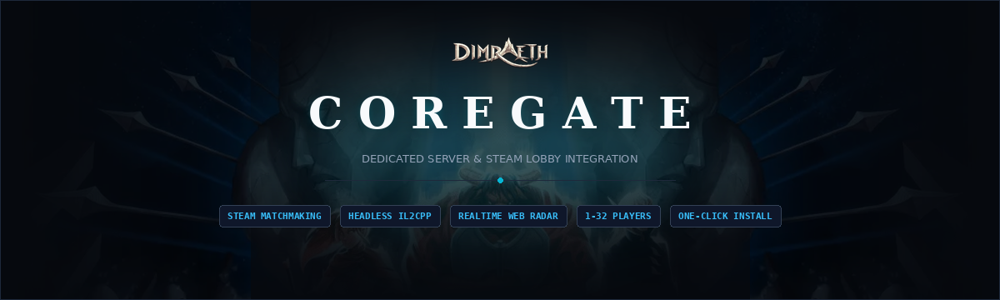

<p align="center">
  
</p>

# COREGATE

High-performance, open-source dedicated server for *Dimraeth* (Mudtek, Steam AppID 2402680).

COREGATE runs *Dimraeth* fully headless on a Windows host and registers the world into Steam's native lobby matchmaking, so players find your realm in the in-game **Browse Servers / Join Game** list and connect directly through Steam. No port forwarding, no third-party connect tool required for players.

---

## Server Editions

COREGATE can run in two configurations depending on your hosting needs:

| Edition | Description | Best For |
| :--- | :--- | :--- |
| **Pure Headless CLI** | Command-line runtime (`-batchmode -nographics`). Disables the web admin plugin, binds zero web ports, deploys no static web assets. | VPS hosts, terminal-based environments, and operators who prefer pure console/SSH control. |
| **Headless + Web Admin Dashboard** | Full dedicated server paired with a browser-based management portal on TCP port 15574 (real-time interactive world map, online player list, live console, and webhook alerts). | Community hosts, clan servers, and interactive admins. |

You can choose your edition during initial setup via `install.bat`, or pass `-Edition Headless` / `-Edition WebAdmin` to `install.ps1`.

---

## What's in the Box

| Component | File | Purpose |
| :--- | :--- | :--- |
| **CoregateHost** | `plugins/CoregateHost.dll` | Headless server runtime: runs the game server in batchmode, manages world saves, and handles Steam lobby matchmaking. |
| **CoregateAdmin** | `plugins/CoregateAdmin.dll` | Admin API and live web server engine (used in Web Admin edition). |
| **Coregate** | `plugins/Coregate.dll` | Dedicated server helper: character admission policies, bed rest fixes, and lobby metadata sync. |
| **CoregateManager** | `scripts/CoregateManager.ps1` | First-run setup wizard, console menu, and Windows control panel: start, stop with safe world save, configure. |
| **Installer** | `install.bat`, `install.ps1` | One-click automated installer: locates the game, deploys plugins and web assets, registers shortcuts and scheduled tasks. |
| **Web Dashboard** | `web/` | Live interactive world map, player inspector, console, and Discord alerts on port 15574. |

---

## Features

- **In-game server browser discovery** through native Steam lobby matchmaking.
- **Headless runtime**: `-batchmode -nographics`, minimal CPU and memory overhead.
- **Player capacity** configurable from 1 to 32 seats (game default is 4).
- **Two operating modes**: Pure Headless CLI (zero web ports) or Headless + Web Admin Dashboard (port 15574).
- **Character admission gate** (optional): enforce Level 1 starting characters to maintain realm balance.
- **Personal bed rest**: sleeping heals the player and restores vitals immediately without forcing night-skip or freezing the rest of the server.
- **Management**: first-run wizard, console menu, GUI panel, and `-Start` / `-Stop` / `-Restart` / `-Status` switches for scripting or SSH.

---

## Requirements

- Windows 10, Windows 11, or Windows Server 2019+
- *Dimraeth* installed and up to date through Steam
- The Steam client running and logged in on the host, with an account that owns *Dimraeth*
- BepInEx 6 IL2CPP installed in your Dimraeth folder

---

## Installation

1. Install **BepInEx 6.0 (IL2CPP x64)** into your *Dimraeth* game directory (where `Dimraeth.exe` is located). Run the game once to allow BepInEx to generate its folder structure, then exit.
2. Download or clone **COREGATE**.
3. Run `install.bat` (or `powershell -ExecutionPolicy Bypass -File .\install.ps1`).
   - Select **[1] Pure Headless CLI** or **[2] Headless + Web Admin Dashboard**.
   - Additional flags: `-Edition Headless|WebAdmin`, `-WithGate` / `-NoGate`, `-CustomGameDir "<path>"`.
4. The installer automatically:
   - Locates your Dimraeth installation via Steam registry
   - Deploys Coregate plugins and web assets
   - Registers the on-demand `CoregateServer` scheduled task
   - Creates **COREGATE Setup (CMD)** and **COREGATE Control (GUI)** desktop shortcuts
5. Complete the first-run configuration wizard (server name, world name, player cap, passwords).
6. Start the server from the menu, GUI, or command line. Once scenes finish loading, it appears in the in-game server browser!

---

## Managing the Server Remotely

`C:\Coregate\CoregateManager.ps1 -Start` runs the `CoregateServer` scheduled task, which launches the game in the logged-in desktop session. That is what lets the game reach Steam when you start it over SSH or another non-interactive session. `-Stop` triggers a clean world save, then safely halts the process.

```powershell
powershell -ExecutionPolicy Bypass -File C:\Coregate\CoregateManager.ps1 -Status
powershell -ExecutionPolicy Bypass -File C:\Coregate\CoregateManager.ps1 -Restart
```

---

## License

MIT License. See [LICENSE](LICENSE) for details.
